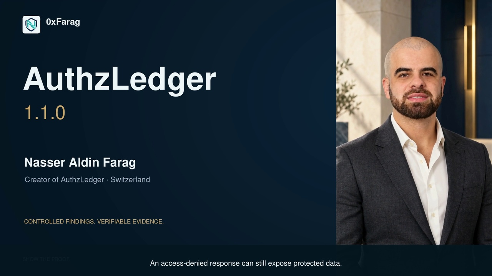
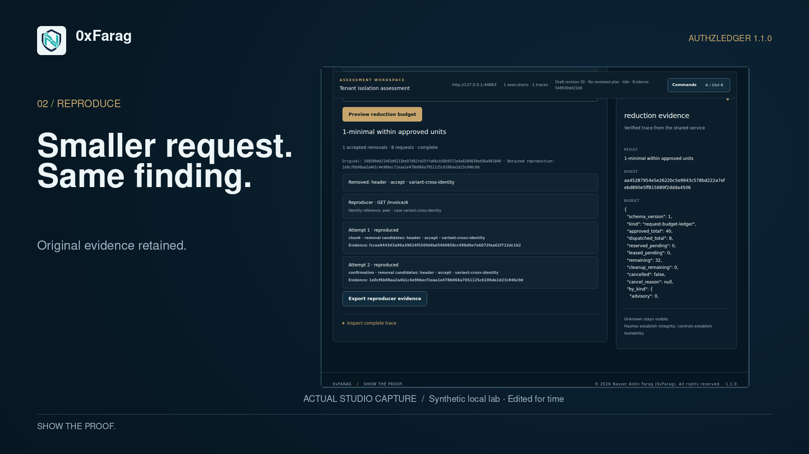
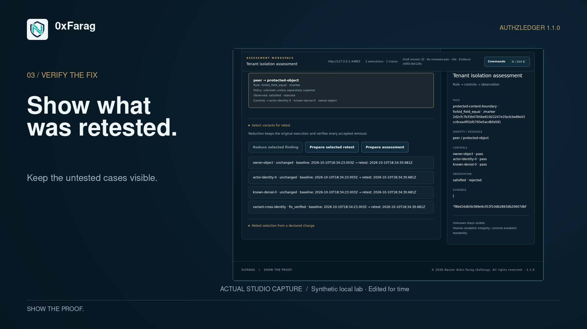
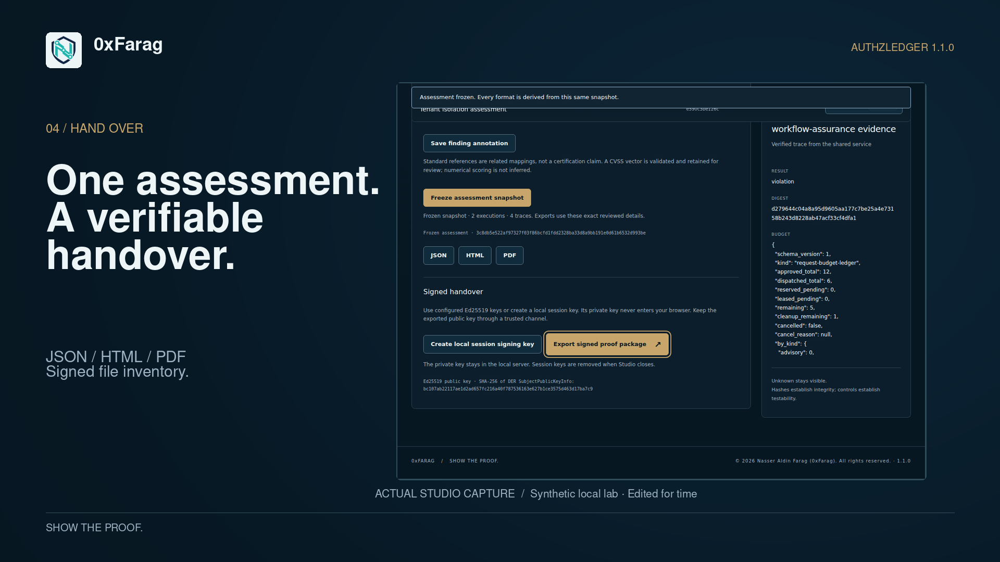

# AuthzLedger 1.5.0

**A local assessment suite that connects expert pentesting from permitted scope to reproducible evidence.**

**[DOWNLOAD 1.5.0 →](https://github.com/0xFarag/0xFarag/releases/tag/v1.5.0)** · **[VIEW VERSIONED SOURCE →](https://github.com/0xFarag/0xFarag/tree/v1.5.0)** · **[VERIFY THE RELEASE →](https://github.com/0xFarag/0xFarag/actions/runs/39477528355)**

Published 20 October 2026 · Nasser Aldin Farag / 0xFarag · Switzerland

**682/682 tests, zero failures or skips · 8/8 browser suites · 3 reproducible demos.** The release tag binds commit `03aea857e35358ddeb13d2a861b633e60c1ca873`. All six public release assets were downloaded and matched against the verified CI artifacts and SHA-256 digests.

## Suite workflow

**Discover → Assess → Investigate → Retest → Report → Proof**

| Stage | What stays connected |
| :--- | :--- |
| **Engagement** | Persistent workspace, explicit scope/RoE references, identities, expiry and execution budgets. |
| **Recon** | Imported traffic and selected scanner outputs, bounded HTTP/API discovery and explicit TCP service observations in one surface catalog. |
| **Assessment** | Curated versioned AuthZ, business-logic and selected web checks; prerequisites, controls, observations and `hint / candidate / confirmed / inconclusive`. |
| **PoC and investigation** | Source-bound recipes, bounded Minimal Reproducer and static approved playbooks; the Inspector retains the selected evidence context. |
| **Retest** | Selected original claims and fresh prerequisite controls; `fix_verified` can coexist with `not_retested`. |
| **Handover** | Impact, remediation, review decisions and coverage in JSON/HTML/PDF from one frozen snapshot; Ed25519-signed inventory and an independent verifier. |

Studio and CLI use the same application services and existing ExecutionContext. Active work requires an exact approved scope and plan. Imported Nmap/Nuclei assertions and version matches remain hints until supported controlled checks establish evidence. The adapters import selected offline result profiles; they do not launch those scanners.

Native detection is bounded to its documented predicates. Arithmetic evaluation is not general SQL injection or code execution; reflected CORS headers are not proof of browser-readable data. Signatures bind delivered bytes to the trusted key, not the truth of remote execution.

[Complete architecture, check boundaries and 30 acceptance criteria](https://github.com/0xFarag/0xFarag/blob/v1.5.0/docs/suite-1.5.0.md) · [Demos and release contract](https://github.com/0xFarag/0xFarag/blob/v1.5.0/docs/release-1.5.0.md)

## Run the 1.5.0 suite

Python 3.10+ and OpenSSL with Ed25519 support are required. The reporting extra installs the pinned PDF dependency.

```sh
git clone --branch v1.5.0 --depth 1 https://github.com/0xFarag/0xFarag.git authzledger
cd authzledger
python3 -m venv .venv
. .venv/bin/activate
python -m pip install '.[reports]'
python -m authzledger studio --open
```

Studio defaults to persistent local history at `~/.authzledger/history.sqlite3`. Use `--history ./engagement.sqlite3` for a selected file or `--session-only` for an explicit ephemeral session. Credentials remain runtime-only. Reopening the workspace does not automatically replay interrupted requests.

Run the three owned-loopback demonstrations with a fresh output directory:

```sh
python -m authzledger assessment demo150 --out artifacts/suite-demo \
  --standalone-verifier tools/verify_bundle.py
```

| Demo | Evidence |
| :--- | :--- |
| **A — beyond status codes** | Protected content in a 403 is confirmed with valid controls; invalid controls remain inconclusive; a 200 error object is rejected. |
| **B — discovery to finding** | Scoped HTTP/TCP discovery leads to a controlled check of an explicitly required response header. |
| **C — fix and handover** | A selected fix is verified while another case remains `not_retested`; both verifiers reject a one-byte report modification. |

These synthetic demos execute 39 HTTP requests and one TCP service connection. Their receipts describe those fixtures, not production coverage or a competitor benchmark.

## Inspect the 1.5.0 release

| Download | Purpose |
| :--- | :--- |
| [Source archive](https://github.com/0xFarag/0xFarag/releases/download/v1.5.0/authzledger-1.5.0-source.zip) | Versioned code, documentation and fixtures. |
| [Python wheel](https://github.com/0xFarag/0xFarag/releases/download/v1.5.0/authzledger-1.5.0-py3-none-any.whl) | Installable distribution, tested outside the source checkout. |
| [Proof package](https://github.com/0xFarag/0xFarag/releases/download/v1.5.0/authzledger-1.5.0-proof.zip) | Synthetic A/B/C evidence, JSON/HTML/PDF and signed handover. |
| [Standalone verifier](https://github.com/0xFarag/0xFarag/releases/download/v1.5.0/verify_bundle.py) | Verify the exact signed inventory using a separately trusted public key. |
| [Verification receipt](https://github.com/0xFarag/0xFarag/releases/download/v1.5.0/verification.json) | Actual command results, unit counts, source/commit binding and log hashes. |
| [SHA-256 checksums](https://github.com/0xFarag/0xFarag/releases/download/v1.5.0/SHA256SUMS.txt) | Compare the five other distributed assets. |

[Installation guide](https://github.com/0xFarag/0xFarag/blob/v1.5.0/INSTALL.md) · [Passing CI](https://github.com/0xFarag/0xFarag/actions/runs/39477528355) · [Release](https://github.com/0xFarag/0xFarag/releases/tag/v1.5.0) · [Rights and commercial licensing](AUTHZLEDGER_RIGHTS.md)

## Historical 1.1.0 walkthrough

The following film, screenshots, commands, metrics and operating notes document **1.1.0**, the preserved authorization foundation. Use the 1.5.0 instructions and downloads above for the current suite. In particular, the old session-only default described below does not apply to 1.5.0.

### Find the authorization gap. Prove the fix.

**A local authorization testing and evidence workbench for pentesters, AppSec teams and security engineers.**

A captured request is the beginning. AuthzLedger connects the access rule, the test identities, the controls, the observation, the reproducer and the retest — so another person can inspect how you reached the finding and what changed after the fix.

[](https://www.youtube.com/watch?v=vEaYxBpsLGw)

**[WATCH THE FILM →](https://www.youtube.com/watch?v=vEaYxBpsLGw)** · **[DOWNLOAD 1.1.0 →](https://github.com/0xFarag/0xFarag/releases/tag/v1.1.0)** · **[RUN THE LAB ↓](#run-the-local-lab)** · **[DISCUSS A PILOT →](https://www.linkedin.com/in/nasser-aldin-farag-974697412/)**

**88/88 acceptance scenarios · 530 Python tests · 7 Chromium browser suites**  
Published 10 October 2026 · Created by Nasser Aldin Farag / 0xFarag · Switzerland

[Capabilities](#the-complete-workbench) · [Product walkthrough](#walk-through-the-product) · [Local lab](#run-the-local-lab) · [Proof and downloads](#inspect-the-release) · [Operating boundaries](#evidence-and-operating-boundaries)

### The complete workbench

**Request → Rule → Controls → Finding → Reproducer → Retest → Signed handover**

Each stage retains its relationship to the original evidence. The Studio and CLI share execution and assessment services, so the interface you choose does not define a different test engine.

| Capability | What you can do |
| :--- | :--- |
| **01 · Bring your traffic** | Import native Burp raw request/response pairs, ZAP JSON+ and HAR. Review redaction and bind the source to an explicit test scope. |
| **02 · Contrast Lab** | Test BOLA/IDOR, tenant isolation and denial-data leakage with identity, owner and denial controls attached to each finding. |
| **03 · Workflow Contracts** | Exercise ordered business flows, skipped approvals, replay and idempotency. Verify the effect through independent state reads. |
| **04 · Minimal Reproducer** | Remove selected request fields through bounded, controlled experiments. Retain the original finding and evidence for every accepted reduction. |
| **05 · Source-bound retests** | Retest selected cases with fresh controls and unchanged rule bindings. Keep verified fixes and untested cases visibly distinct. |
| **06 · One Studio and CLI** | Work through a keyboard-first assessment workspace, shared matrix/graph selection, persistent Inspector and the same underlying execution services. |
| **07 · Evidence handover** | Freeze JSON, HTML and PDF from one assessment. Include reviewed standards mappings and an Ed25519-signed file inventory. |
| **08 · Change and assurance** | Explain impacted-case selection, inspect evidence relationships and run bounded assurance cycles with checked history and shared request budgets. |

#### Three questions an authorization finding must answer

| Question | Product capability | Evidence to inspect |
| :--- | :--- | :--- |
| **Was the boundary actually crossed?** | Contrast Lab binds the rule, principal, protected resource and controls to the observation. | Original execution, control results, selected observations and Inspector provenance. |
| **Can another engineer reproduce it?** | Bounded reduction tests selected removals while preserving the same violation. | Original request, accepted reduction steps and the retained reproducer. |
| **Did the fix hold for the tested scope?** | Source-bound retests compare selected cases under unchanged rule bindings. | Baseline, fresh controls, current execution and explicit `not_retested` cases. |

### Walk through the product

#### 01 · Bring a captured request into a controlled experiment


Import native Burp raw messages, ZAP JSON+ or HAR. Review the source, bind identities and define the access rule. Preview the exact scope and request budget before execution.

Contrast Lab supports explicit tests for object-level access failures, tenant isolation and protected content leaking through a denial response. The interpretation depends on the configured controls and observed content. A `403` containing the protected marker can establish a finding; in the illustrated lab, a `200` containing only an error object and no protected marker does not establish data disclosure.

**What stays attached:** rule, identity, resource, controls, observation, finding and original report.

#### 02 · Reduce the request while keeping the proof



Choose the request units that may be removed. AuthzLedger tests candidates with fresh controls and accepts a reduction only when it retains the same verified violation. The original execution remains unchanged.

In the separate CLI demonstration, three selected irrelevant units are removed with twelve total requests, including controls. A limited budget preserves the last proven candidate and the actual minimality status.

**What you hand over:** a smaller reproducer, the original evidence and the chain of accepted changes.

#### 03 · Prove the fix for the cases you retested



Select the relevant cases, include their control dependencies and execute the retest. A changed access rule or an invalid identity control cannot silently become a verified fix.

The separate public 100-case demonstration selects seven variants and three controls: ten retest requests. All 90 omitted cases retain their historical evidence and remain `not_retested`.

**What the reviewer sees:** which fix was verified, under which source contract, at what time, and which cases still need testing.

#### 04 · Deliver an assessment that can be inspected



Freeze an assessment once and render JSON, HTML and PDF from that snapshot. Export the reports and retained evidence with an Ed25519-signed file inventory.

Reports support reviewed mappings to **ASVS 5.0.0, WSTG 4.2 and the OWASP API Security Top 10 (2023)**, plus reviewed **CVSS 4.0** vectors. Coverage remains specific to the assessed requirements.

A separate verifier checks the signed inventory and report anchors against a trusted public key. The application verifier additionally checks the supported source-bound assessment and comparison semantics.

**What travels with the report:** original evidence, reproducer, retest comparison, snapshot and verifiable file inventory.

*All product images on this page show actual Studio captures from synthetic local fixtures. The founder film uses the approved presentation and voice; it is not customer footage.*

### Beyond individual requests

#### Workflow Contracts

Model ordered business operations such as creation, approval, completion and readback. Test skipped transitions, replay and idempotency with fresh fixtures, typed bindings and explicit mutation approval. Independent pre-/post-state reads establish whether the business effect occurred. Budget is reserved for the required checks and cleanup.

#### Evidence graph and change analysis

Follow the relationship from rule and plan through controls, observations and findings. Keep intended permission, policy decision and observed application behavior distinct. Review explained retest selections from declared changes; an unknown dependency requires the full scope.

#### Bounded assurance

Run a finite set of assurance cycles within one shared request budget. Check history integrity and freshness, preserve original traces, and use fresh workflow fixtures. File-backed history is available when explicitly configured.

#### Keyboard-first Studio

Move between assessment stages with the command palette and keyboard. Keep the selected finding and Inspector context across matrix, graph and history views. Review the plan before dispatch; changes invalidate the prior approval. Use the CLI for the same underlying services and reproducible local workflows.

### Run the local lab

Start with the published **`v1.1.0`** tag. These commands create a local environment, install the PDF-report dependency and run synthetic loopback demonstrations:

```sh
git clone --branch v1.1.0 --depth 1 https://github.com/0xFarag/0xFarag.git authzledger
cd authzledger
python3 -m venv .venv
. .venv/bin/activate
python -m pip install '.[reports]'
python -m authzledger assessment demo --out artifacts/assessment-demo
```

Use a new output directory for each run. The demo produces three inspectable results:

| Demonstration | Result |
| :--- | :--- |
| Import → controlled finding → reduction | Original execution and a smaller reproducer with retained evidence. |
| Denial content and invalid controls | Protected content in a 403 is confirmed with valid controls; invalid controls remain inconclusive. |
| Selective retest and proof | Selected fix `fix_verified`, omitted case `not_retested`, consistent reports and a signed proof package. |

Open the Studio with durable run history:

```sh
python -m authzledger studio --history ./authorization-history.sqlite3 --open
```

Verify the demo proof:

```sh
python -m authzledger verify-bundle artifacts/assessment-demo/proof \
  --public-key artifacts/assessment-demo/trusted-public.pem
```

Python 3.10+ and `venv` are required; signing needs OpenSSL with Ed25519 support. Linux/CPython 3.12 is the measured environment. The local labs need no external target credentials or paid service. Use remains subject to the repository licence and any separately agreed permissions.

**[Full installation and independent verification guide →](https://github.com/0xFarag/0xFarag/blob/v1.1.0/INSTALL.md)**

### Inspect the release

| Download | Purpose |
| :--- | :--- |
| [Source archive](https://github.com/0xFarag/0xFarag/releases/download/v1.1.0/authzledger-1.1.0-source.zip) | Versioned source, documentation, fixtures and retained evidence. |
| [Python wheel](https://github.com/0xFarag/0xFarag/releases/download/v1.1.0/authzledger-1.1.0-py3-none-any.whl) | Installable 1.1.0 distribution. |
| [Synthetic proof package](https://github.com/0xFarag/0xFarag/releases/download/v1.1.0/authzledger-1.1.0-proof.zip) | Retained demonstrations and the separate 100-case selective-retest proof. |
| [Standalone verifier](https://github.com/0xFarag/0xFarag/releases/download/v1.1.0/verify_bundle.py) | Inspect signed package integrity with a separately trusted key. |
| [SHA-256 checksums](https://github.com/0xFarag/0xFarag/releases/download/v1.1.0/SHA256SUMS.txt) | Verify the four distributed files. |

The release tag is bound to `a7160e13289ea0983946e03c978bc6af1841a7e6`. All three jobs in the [publication workflow](https://github.com/0xFarag/0xFarag/actions/runs/38080406879) passed: browser acceptance, verification and publication. All five published asset hashes matched the reviewed release.

[Acceptance ledger](https://github.com/0xFarag/0xFarag/blob/v1.1.0/docs/acceptance-1.1.0.md) · [Retained evidence](https://github.com/0xFarag/0xFarag/blob/v1.1.0/evidence/1.1.0-final/README.md) · [Native Burp import profile](https://github.com/0xFarag/0xFarag/blob/v1.1.0/docs/burp-native-import-v1.md) · [Reporting profile](https://github.com/0xFarag/0xFarag/blob/v1.1.0/docs/reporting-profile-1.1.0.md)

### Bring a pilot

**For AppSec teams and pentest consultancies:** evaluate the workflow on an explicitly authorized assessment, from captured request to developer handover and scoped retest.

**For security-tooling investors:** discuss the product, technical evidence and planned commercial validation. The immediate objective is pilot usage, repeatable handovers and evidence of willingness to pay. Hosted team workflows are a development direction.

**[Contact Nasser Aldin Farag on LinkedIn →](https://www.linkedin.com/in/nasser-aldin-farag-974697412/)**

[LinkedIn launch](https://linkedin.com/feed/update/urn:li:ugcPost:7514772443983638528) · [Release film](https://www.youtube.com/watch?v=vEaYxBpsLGw) · [Instagram reel](https://www.instagram.com/reel/DeU3KUajwNT/) · [TikTok launch](https://www.tiktok.com/@omarf4206/video/7695126948086943009)

### Evidence and operating boundaries

- **Local execution:** import and export are offline; authorized tests send requests only within the reviewed scope and budget. Runtime credential bindings are redacted from retained evidence.
- **Explicit control validity:** failed controls or ambiguous observations remain inconclusive. Optional local AI provides advisory explanations and does not decide findings.
- **Supported imports:** native Burp raw request/response pairs, ZAP JSON+ and HAR use documented profiles. DTD-bearing Burp XML remains rejected.
- **Verification:** signatures establish package integrity. They do not independently prove truthful remote execution or complete production coverage. Authenticate the verification key through a separate trusted channel.
- **History:** use an explicit history file for durable runs. Without it, Studio history is session-only; retain exported evidence before closing.
- **Scope:** the published engineering checks use synthetic local fixtures. Standards mappings document assessed coverage and are not an independent certification.

© 2026 **Nasser Aldin Farag / 0xFarag**. Source-visible; proprietary rights reserved. [Rights and commercial licensing](AUTHZLEDGER_RIGHTS.md) · [Development direction](AUTHZLEDGER_DIRECTION.md).
