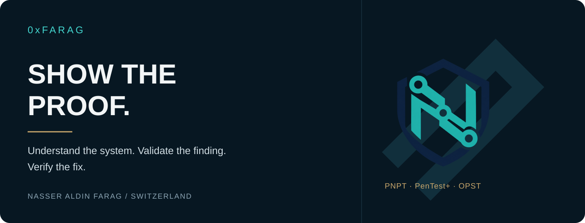

# Nasser Aldin Farag · 0xFarag

**[AuthzLedger 1.1.0 — release, source and downloads →](https://github.com/0xFarag/0xFarag/releases/tag/v1.1.0)**

**Penetration Testing · Web & API Security · Security Engineering**  
Zürich, Switzerland

I bring more than ten years of system engineering experience and a background in web security to practical security assessment. My work follows a clear standard: understand the system, reproduce the finding, explain its impact and verify the fix.

My focus is application security, authorization testing and security automation. I build reproducible working examples that make technical reasoning and remediation inspectable.

**Open to permanent roles in penetration testing, Web/API security, AppSec and security engineering in Switzerland.** I am also the creator of AuthzLedger, an authorization testing and evidence workbench for pentesters and AppSec teams.

[LinkedIn](https://www.linkedin.com/in/nasser-aldin-farag-974697412/) · [GitHub projects](https://github.com/0xFarag?tab=repositories) · [YouTube](https://www.youtube.com/@0xFarag) · [TryHackMe](https://tryhackme.com/p/0xFarag)

## AuthzLedger 1.1.0

### Find the authorization gap. Prove the fix.

**The local authorization testing and evidence workbench for pentesters and AppSec teams.**

Bring captured traffic into controlled experiments. Turn a finding into a smaller reproducer. Retest the fix and deliver the evidence behind it — through one Studio and CLI.

**[WATCH THE 52-SECOND FILM →](https://www.youtube.com/watch?v=vEaYxBpsLGw)** · **[EXPLORE ALL CAPABILITIES →](AUTHZLEDGER.md)** · **[DOWNLOAD 1.1.0 →](https://github.com/0xFarag/0xFarag/releases/tag/v1.1.0)**

### Eight capabilities. One evidence trail.

| Capability | What you can do |
| :--- | :--- |
| **01 · Bring your traffic** | Import native Burp raw request/response pairs, ZAP JSON+ and HAR. Review redaction and bind the source to an explicit test scope. |
| **02 · Contrast Lab** | Test BOLA/IDOR, tenant isolation and denial-data leakage with identity, owner and denial controls attached to each finding. |
| **03 · Workflow Contracts** | Exercise ordered business flows, skipped approvals, replay and idempotency. Verify the effect through independent state reads. |
| **04 · Minimal Reproducer** | Remove selected request fields through bounded, controlled experiments. Retain the original finding and evidence for every accepted reduction. |
| **05 · Source-bound retests** | Retest selected cases with fresh controls and unchanged rule bindings. Keep verified fixes and untested cases visibly distinct. |
| **06 · One Studio and CLI** | Work through a keyboard-first assessment workspace, shared matrix/graph selection, persistent Inspector and the same underlying execution services. |
| **07 · Evidence handover** | Freeze JSON, HTML and PDF from one assessment. Include reviewed standards mappings and an Ed25519-signed file inventory. |
| **08 · Change and assurance** | Explain impacted-case selection, inspect evidence relationships and run bounded assurance cycles with checked history and shared request budgets. |

*Actual Studio capture · Synthetic local fixture. [Walk through the product, with real screens →](AUTHZLEDGER.md#walk-through-the-product)*

### See what changes the finding

| In the local lab | What AuthzLedger establishes |
| :--- | :--- |
| **403 response, protected data still present** | A confirmed disclosure when the identity, owner and denial controls are valid. |
| **A request with removable fields** | A smaller reproducer with fresh controls and a retained chain back to the original. |
| **100-case baseline; seven variants selected** | Ten retest requests including three controls. The other 90 cases stay explicitly `not_retested`. |
| **A report ready for handover** | JSON, HTML and PDF from one frozen assessment, with a signed file inventory and separate verification. |

**88/88 acceptance scenarios · 530 Python tests · 7 Chromium suites.** [Inspect the release checks](https://github.com/0xFarag/0xFarag/actions/runs/38080406879) · [Read the acceptance ledger](https://github.com/0xFarag/0xFarag/blob/v1.1.0/docs/acceptance-1.1.0.md).

### Run it. Inspect it. Bring a pilot.

**[Start the local lab →](AUTHZLEDGER.md#run-the-local-lab)** · [Installation guide](https://github.com/0xFarag/0xFarag/blob/v1.1.0/INSTALL.md) · [Source ZIP](https://github.com/0xFarag/0xFarag/releases/download/v1.1.0/authzledger-1.1.0-source.zip) · [Wheel](https://github.com/0xFarag/0xFarag/releases/download/v1.1.0/authzledger-1.1.0-py3-none-any.whl) · [Proof package](https://github.com/0xFarag/0xFarag/releases/download/v1.1.0/authzledger-1.1.0-proof.zip)

**AppSec teams, pentest consultancies and security-tooling investors:** [contact me on LinkedIn](https://www.linkedin.com/in/nasser-aldin-farag-974697412/) to discuss a pilot, reproducible handovers and the path from local assessments to team workflows.

Built by **Nasser Aldin Farag / 0xFarag**, Switzerland. Source-visible, with proprietary rights reserved. [Commercial licensing](AUTHZLEDGER_RIGHTS.md) · [Technical boundaries](AUTHZLEDGER.md#evidence-and-operating-boundaries) · [Development direction](AUTHZLEDGER_DIRECTION.md).

## Selected engineering work

| Project | Purpose | What to inspect |
| :--- | :--- | :--- |
| [**API Authorization Lab**](https://github.com/0xFarag/api-authorization-lab) | Make object-level authorization failures reproducible. | Local invoice API, ownership enforcement and before/after HTTP evidence. |
| [**Nmap Evidence Report**](https://github.com/0xFarag/nmap-evidence-report) | Turn scan output into usable assessment evidence. | Offline XML processing, Markdown/JSON reports and preservation of observed states. |
| [**Pentest Case Study**](https://github.com/0xFarag/pentest-case-study) | Connect a technical finding to a clear remediation decision. | Scope, impact, request/response evidence, fix and retest. |
| [**Offensive Security Labs**](https://github.com/0xFarag/offensive-security-labs) | Explore security boundaries through executable examples. | Exploit/fix pairs across OAuth, SSRF, CI and API security, with regression checks. |
| [**TryHackMe Reports**](https://github.com/0xFarag/tryhackme-writeups) | Document technical reasoning and lessons from completed rooms. | Learning retrospectives, remediation analysis and proposed retest criteria. |

The runnable labs and sample assessment use synthetic data in local environments. They are separate from client engagements. TryHackMe reports distinguish completed learning activities from proposed retests.

## Technical focus

**Web & API security** — HTTP, authentication boundaries, object-level access control, finding validation and retesting.  
**Systems** — Windows/Linux, networking, operations and system engineering.  
**Security engineering** — Python automation, structured evidence, reproducible tests and clear technical reporting.  
**Continuing development** — Active Directory security, offensive security methodology and red teaming.

## Credentials

| Credential | Issuer | Earned |
| :--- | :--- | :--- |
| **PNPT** — Practical Network Penetration Tester | TCM Security | 2024 |
| **PenTest+** | CompTIA | 2024 |
| **OPST** — OSSTMM Professional Security Tester | ISECOM | 2024 |
| **PJPT** | TCM Security | 2023 |
| **eJPT** | INE | 2023 |
| **CC** — Certified in Cybersecurity | ISC² | 2024 |
| **ICCA** — INE Certified Cloud Associate | INE | 2023 |
| **Google Cybersecurity Professional Certificate** | Google | 2023 |

## Work with me

I am seeking a permanent cybersecurity role in Switzerland, with a focus on penetration testing, Web/API security, AppSec or security engineering. I welcome technical conversations about the trade-offs, test design and evidence behind these projects.

**[Contact me on LinkedIn →](https://www.linkedin.com/in/nasser-aldin-farag-974697412/)**

## Rights and permissions

Copyright © 2026 Nasser Aldin Farag (0xFarag). All rights reserved.

All exclusive rights legally held by me in my own protectable contributions to AuthzLedger and my personal branding remain reserved to me. Publication or delivery does not itself transfer ownership or grant a general commercial licence. Commercial reuse requires a separate written agreement, subject to applicable law and permissions already validly granted. [Rights and commercial licensing](AUTHZLEDGER_RIGHTS.md).
