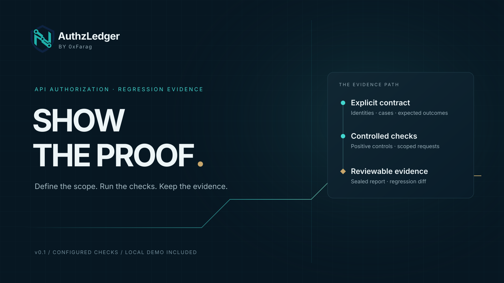

# AuthzLedger 1.5 — controlled assessment suite

**From permitted scope to reproducible evidence.**

Find the authorization gap. Prove the fix. Extend the same discipline to discovery and selected web/API checks.



AuthzLedger is a local assessment workbench for expert pentesters and AppSec teams. It connects explicit scope, captured traffic, discovered surfaces, control-bound checks, source-bound retests and signed handover. Studio and CLI use the same services and execution context.

**1.5 development candidate.** The source is under integration and release review. This README does not declare a stable release, a published tag or completed final CI. See the [release record](docs/release-1.5.0.md) for gates and the [suite implementation map](docs/suite-1.5.0.md) for supported domains and limitations. Historical 1.1.0 evidence and schemas retain their original versions.

[Installation](INSTALL.md) · [Suite architecture and acceptance](docs/suite-1.5.0.md) · [1.5 release record](docs/release-1.5.0.md) · [Release notes](RELEASE_NOTES.md) · [Published releases](https://github.com/0xFarag/0xFarag/releases)

## Start locally

From an authorized source checkout, with Python 3.10+ and OpenSSL with Ed25519 support:

```sh
python3 -m pip install '.[reports]'
python3 -m authzledger studio --open
```

Studio listens on loopback and prints a private authenticated session URL. By default, local history and the platform workspace persist at `~/.authzledger/history.sqlite3`. Choose `--history ./engagement.sqlite3` for an explicit file or `--session-only` for an ephemeral session. Runtime credentials do not persist. Reopening an assessment does not replay interrupted network work.

Choose **Assessment** and create or open a persistent assessment. Set scope and engagement/RoE references, import a source, review discovery or a check, execute the exact approved plan, inspect controls, retest selected findings, and freeze the handover. The Inspector keeps the selected context visible. Advanced JSON remains available for complex specifications. The existing Matrix, Graph, History, Policy and Evidence views remain available.

## Reproduce the three proof workflows

These commands create owned, disposable loopback fixtures and use actual product services:

```sh
python3 -m authzledger assessment demo150 --out artifacts/platform150-demo
python3 tools/check_platform150.py --out artifacts/platform150-check
```

Each output directory must be new. PDF requires the `reports` extra. The demos cover:

| Demo | Evidence |
|---|---|
| A — authorization | Imported request, valid controls, a finding and bounded reduction; separate denial-data disclosure, failed-control and 200-error cases |
| B — discovery to check | Explicit TCP service probe and bounded HTTP discovery, then a supported check confirming the exact configured missing header |
| C — fix proof | Two-finding baseline, one selected retest, `fix_verified` beside `not_retested`, signed reports and rejection after one copied package byte changes |

The receipts record actual requests, service connections, limits, runtime and timings. Fixtures stop before reports are exported or signed. The workspace is closed and reopened. No request count is a product-wide performance claim, and these authored fixtures do not prove production coverage or comparative scanner superiority.

For an installed wheel outside the checkout, supply the independent verifier asset:

```sh
python -I -m authzledger assessment demo150 --out platform150-demo \
  --standalone-verifier /absolute/path/verify_bundle.py
```

## One assessment, connected evidence

| Capability | Supported behavior |
|---|---|
| Persistent workspace | Explicit engagement/RoE references, revision checks, typed evidence, retained source lineage and interrupted-job records |
| Inventory and discovery | Offline traffic/OpenAPI metadata; selected Nmap XML/Nuclei JSONL result adapters; bounded HTTP discovery and explicit TCP service probes |
| Controlled checks | Existing authorization and workflow contracts plus selected configuration, information and arithmetic-expression predicates; each declares controls and an evidence ceiling |
| Static playbooks | Reviewed discovery/check plans composed under one scope and budget; no dynamic attack chaining or arbitrary executable plugins |
| Reproduction and retest | Exact recipes, approved minimal-reproducer reduction and source-bound selected retests; omitted work stays visible |
| Local operational workflows | Finite explicitly invoked schedules, offline surface deltas and a small reviewed CVE knowledge pack with hints only |
| Reports and proof | Frozen JSON/HTML/PDF, full source inventory, Ed25519 packages, main semantic verification and an independent integrity verifier |

A banner match is a hint. CORS response headers are not proof of browser-readable data. The injection check confirms only two configured arithmetic expressions, not SQL injection or remote code execution. A missing configured header is a configuration finding, not an exploitability claim. Profile names do not authorize unsafe requests or imply complete coverage. See the [exact capability boundaries](docs/suite-1.5.0.md).

Nmap and Nuclei adapters import supported offline result profiles; AuthzLedger does not launch those scanners. Burp, ZAP and HAR profiles retain their explicit parsing and provenance boundaries. Discovery never grants permission for a newly observed target.

## Use the same services from CLI

```sh
python3 -m authzledger assessment registry
python3 -m authzledger assessment create --store engagement.sqlite3 \
  --title 'Authorized API assessment' --scope reviewed-scope.json
python3 -m authzledger assessment list --store engagement.sqlite3
```

Create returns an assessment ID. Use it with `surface-import`, `discover-plan`, `check-plan`, `playbook-plan`, `check-retest-plan` and `freeze`. Active `*-run` actions require the exact retained plan ID and `--approve` digest. Run `python3 -m authzledger assessment ACTION --help` for each action's required fields. Planning, import, catalog comparison and evidence verification send no target requests.

Scope binds origin, method, path, purpose, declared effect, allowed networks, expiry and limits. Transport pins validated destinations, disables ambient proxies and does not follow redirects automatically. Controls and active checks share the budget. An operator-supplied authorization reference records context; it does not independently establish target ownership.

## Sign and verify the handover

```sh
python3 -m authzledger keygen --private operator-private.pem --public operator-public.pem
python3 -m authzledger assessment freeze ASSESSMENT_ID --store engagement.sqlite3 --out snapshot.json
python3 -m authzledger assessment report snapshot.json --out reports
python3 -m authzledger assessment bundle snapshot.json --key operator-private.pem --out proof
python3 -m authzledger verify-bundle proof --public-key operator-public.pem
python3 -I tools/verify_bundle.py proof --public-key operator-public.pem
```

Supply a separately trusted public key in a real handover. Signatures bind file bytes and key possession; they do not witness remote execution, prove legal authorization, identify the operator by themselves or provide a trusted timestamp. The main verifier checks supported retained semantics; the standalone verifier checks the signed inventory and anchors without importing AuthzLedger. Neither establishes whole-application security.

## Built on the authorization foundation

The original intent/policy/observation graph, Contrast Lab, Workflow Contracts, bounded Minimal Reproducer, ComparisonEnvelope v1, selective retests, CLI/Studio services and signed evidence remain the foundation. Existing proof roots and historical records are not rewritten. The [1.1 architecture](docs/product-1.1.0.md), [88-scenario historical acceptance ledger](docs/acceptance-1.1.0.md) and [verification record](docs/verification-1.1.0.md) describe that baseline; their counts are not the final 1.5 gate counts.

AuthzLedger concentrates on explainable, reproducible claims in supported domains. Nessus, Qualys, Rapid7 and Greenbone have broad assessment and vulnerability-management capabilities; Burp and ZAP remain useful specialist tools. No market-wide replacement or benchmark superiority is claimed. The suite map defines a fair per-domain comparison method.

## Documentation and rights

- [1.5 suite and gates](docs/suite-1.5.0.md) · [1.5 release record](docs/release-1.5.0.md) · [Unpublished channel drafts and film plan](docs/launch-1.5.0.md)
- [Contracts](docs/contract.md) · [OpenAPI](docs/openapi.md) · [Assessment CLI](docs/assessment-cli.md)
- [Signatures](docs/signatures.md) · [Assurance/history](docs/assurance.md) · [Security model](docs/security-model.md)
- [Validation](docs/validation.md) · [Contributing](CONTRIBUTING.md) · [Historical 1.1 release record](docs/release-1.1.0.md)

The [1.0 walkthrough](https://github.com/0xFarag/0xFarag/releases/download/v1.0.0/AuthzLedger_1.0_Release_wide.mp4) records the earlier release, not the 1.5 suite. A new film is planned; its production is not claimed here.

AuthzLedger is the product project of **Nasser Aldin Farag (0xFarag)**. He directs its product vision, technical scope and principal design decisions. All exclusive rights legally held by him in his own protectable contributions remain reserved to him. Publication, presentation or delivery does not itself transfer ownership or grant a general commercial licence. Commercial reuse requires a separate written agreement, subject to applicable law and permissions already validly granted.

Copyright © 2026 Nasser Aldin Farag (0xFarag). All rights reserved. [Rights and commercial licensing](docs/rights.md) · [LICENSE](LICENSE) · [NOTICE](NOTICE.txt).

Billing is disabled. Independent security review, wider platform coverage, full accessibility and customer validation remain open.
